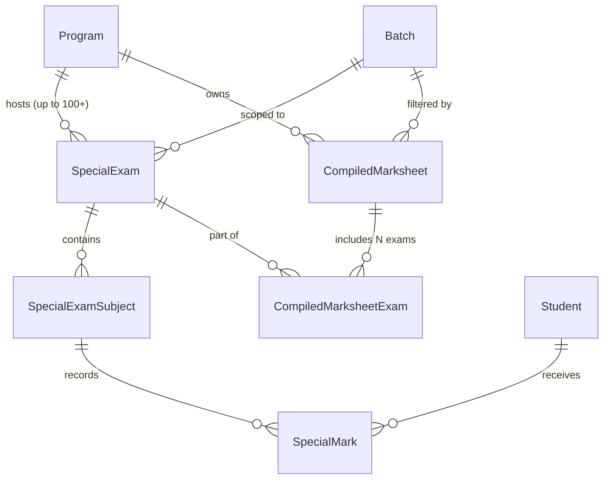
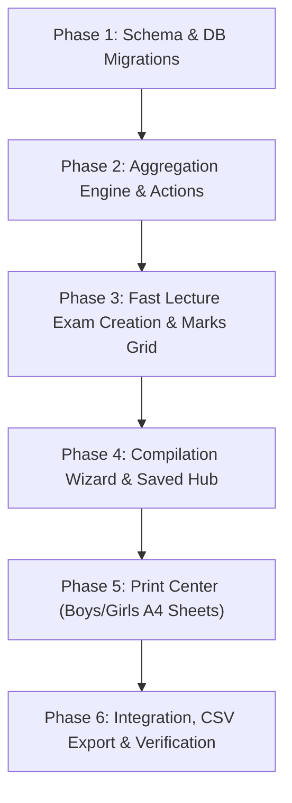

# Compiled Marksheets & Exam System — Implementation Plan

*Science Lab Coaching Center Management System · Special Batch Module Extension*

---

## 1. Executive Summary & Purpose

In the Science Lab Special Batch program (SSC & Junior School), academic assessment is split into two fundamentally different evaluation tracks:

1. **Board-Graded Simulation (Model Tests Only):**
   * **Only Model Tests** produce an official Bangladesh Education Board-style graded academic transcript.
   * Features letter grades (`A+` to `F`), subject grade points (`0.0` to `5.0`), compulsory pass rules (any fail in a compulsory subject causes an overall fail), 4th/optional subject bonus points (`max(0, GP − 2)` added to compulsory GP sum), GPA capped at 5.00, and ranking strictly by **GPA first, then Total Marks**.
2. **Marks-Only Assessments (Class Tests, Pre-Model Tests, Lecture Tests):**
   * Every other exam—including objective-only pre-model tests and daily/weekly lecture class tests—is recorded and reported as **marks only**.
   * No GPA, no letter grades, and no pass/fail calculation.

### The Lecture Exam & Compilation Challenge
A single program may run **up to 100+ lectures** throughout an academic year, with a short exam attached to each lecture (e.g. *Physics L1*, *Chemistry L3*, *English L12*). 

To evaluate sustained student performance over time, the institute requires the ability to:
* **Arbitrarily select any set of exams** (e.g., *Lectures 1 to 10*, *Lectures 11 to 20*, *Month 1 Tests*, or a cumulative *Lectures 1 to 50*).
* **Assign a custom title** to the compiled set (e.g., *"Physics Lecture Series 1–10 Consolidation Sheet"*).
* **Aggregate and rank without grading:** Sum each student’s marks across all selected exams, calculate row totals, and assign competition ranks (`1, 1, 3...`) based strictly on total marks obtained.
* **Preserve historical immutability:** Compiling a new sheet (e.g., *Lectures 11 to 20*) must never overwrite, alter, or invalidate earlier compiled sheets.
* **Reopen, Reprint, and Filter:** Any saved marksheet can be retrieved at any time, filtered by **Boys** or **Girls** section (or combined), and printed cleanly on A4 paper or exported for sharing.

This document details the complete end-to-end implementation plan for this architecture.

---

## 2. Core Architectural Decisions

| Decision Area | Specification | Rationale |
| :--- | :--- | :--- |
| **Exam Result Dual Track** | `MODEL_TEST` = Graded Board Result.<br>`CLASS_TEST`, `PRE_MODEL`, `LECTURE_TEST`, `OTHER` = Marks Only. | Matches official coaching center policy. Students and guardians receive GPA and letter grades only for comprehensive board simulations. |
| **Compiled Sheet Persistence** | Save compilation definitions in a dedicated table (`CompiledMarksheet`) linked to selected exams via a junction table (`CompiledMarksheetExam`). | Guarantees earlier marksheets (e.g. L1–L10) are permanently preserved and reproducible even when new exams (L11–L100) are created. |
| **Ranking Algorithm** | Standard Competition Ranking (`1, 1, 3...`) strictly by **Total Marks Obtained** (descending). | Students with equal cumulative marks share the same rank; the subsequent position skips accordingly. |
| **Absent / Unmarked Handling** | If a student was absent or unmarked in a specific lecture exam, their score for that exam is `0` (with visual tag `ABS` on the breakdown grid). The student remains on the compiled sheet and is never dropped from the roster. | Prevents silent dropout of students from long lecture series. |
| **Section Isolation** | Marksheets can be scoped to a specific Section Batch (e.g., Boys 2620, Girls 2610) or compiled across the entire Program with instant section toggling in the viewer. | Routine and exam administration are gender-segregated in the SSC and Junior programs. |
| **Dynamic Matrix Performance** | Compute aggregates deterministically on load using efficient Prisma batching, with optional materialized summary caching for archived sheets. | Allows retroactively correcting an exam mark if needed, while keeping compilations lightweight and fast. |

---

## 3. Data Model Additions (`prisma/schema.prisma`)

To support high-volume lecture exams and compiled marksheets without disturbing existing tables, the following additive changes are defined:



### 3.1 Extensions to `SpecialExam`

Add explicit lecture metadata to identify lecture numbers cleanly:

```prisma
model SpecialExam {
  id           Int                  @id @default(autoincrement())
  programId    Int
  batchId      Int?                 // Nullable: applies to all batches or specific section
  title        String               // e.g. "Physics Lecture 05 Short Test"
  kind         String               // "MODEL_TEST" | "CLASS_TEST" | "PRE_MODEL" | "LECTURE_TEST"
  lectureNo    Int?                 // e.g. 1, 2, ... 100 (for sequential sorting)
  lectureLabel String?              // e.g. "L-05", "Ch-03 Part 1"
  examDate     DateTime
  status       String               @default("COMPLETED") // "SCHEDULED", "COMPLETED"
  createdAt    DateTime             @default(now())

  program      Program              @relation(fields: [programId], references: [id], onDelete: Cascade)
  batch        Batch?               @relation(fields: [batchId], references: [id])
  subjects     SpecialExamSubject[]
  compilations CompiledMarksheetExam[]

  @@index([programId, kind])
  @@index([programId, lectureNo])
  @@map("special_exams")
}
```

### 3.2 New Entities: `CompiledMarksheet` & Junction

```prisma
model CompiledMarksheet {
  id          Int                     @id @default(autoincrement())
  programId   Int
  batchId     Int?                    // Nullable: if scoped to a specific section batch
  title       String                  // e.g. "Physics Lectures 01-10 Compilation"
  description String?                 // Optional notes: "Evaluated during Sep 2026"
  createdAt   DateTime                @default(now())
  updatedAt   DateTime                @updatedAt
  createdBy   String?                 // Admin / Staff username

  program     Program                 @relation(fields: [programId], references: [id], onDelete: Cascade)
  batch       Batch?                  @relation(fields: [batchId], references: [id])
  exams       CompiledMarksheetExam[]

  @@index([programId])
  @@map("compiled_marksheets")
}

model CompiledMarksheetExam {
  id                  Int               @id @default(autoincrement())
  compiledMarksheetId Int
  specialExamId       Int
  sortOrder           Int               @default(0) // Order of appearance as columns

  compiledMarksheet   CompiledMarksheet @relation(fields: [compiledMarksheetId], references: [id], onDelete: Cascade)
  specialExam         SpecialExam       @relation(fields: [specialExamId], references: [id], onDelete: Cascade)

  @@unique([compiledMarksheetId, specialExamId])
  @@index([compiledMarksheetId])
  @@map("compiled_marksheet_exams")
}
```

---

## 4. Computation Engine Specification

### 4.1 Track A: Model Test Engine (Board Graded)
Used **exclusively** when `exam.kind === 'MODEL_TEST'`:
* Inputs: Batch roster, marks for CQ, MCQ, Practical, Grade scale (80%=5, 70%=4, etc.), Result rule (GP−2 bonus).
* Combined papers evaluated as single composite group (Bangla 1st + 2nd, English 1st + 2nd).
* Compulsory subject failure (GP 0) results in overall fail (GPA 0.00).
* Optional subject failure does not fail the student.
* Ranking: **GPA (descending) → Total Marks (descending)**.

### 4.2 Track B: Compiled Marksheet Engine (Ungraded Aggregation)
Used when compiling any set of $N$ exams ($E_1, E_2, \dots, E_N$):

```
Student Total = Mark(E_1) + Mark(E_2) + ... + Mark(E_N)
Maximum Possible = MaxMark(E_1) + MaxMark(E_2) + ... + MaxMark(E_N)
Percentage = (Student Total / Maximum Possible) * 100
```

#### Detailed Algorithm Steps:
1. **Roster Acquisition:** Fetch all active students belonging to the target Program and Section (Boys, Girls, or Combined). No student is excluded.
2. **Column Matrix Assembly:** For each selected exam $E_i$, determine the student’s score:
   * If `isAbsent === true`: mark is `0` (flagged as `ABS`).
   * If unmarked/missing: mark is `0` (flagged as `UNMARKED`).
   * Otherwise: sum of subject components (`cq + mcq + practical` or `singleMark`).
3. **Row Summation:** Calculate `totalObtained` across all selected exams for each student.
4. **Percentage Calculation:** Compute percentage against the total possible marks across all $N$ exams.
5. **Competition Ranking (Ties Share Rank):**
   * Sort students descending by `totalObtained`.
   * Secondary sort by Roll serial ascending (for predictable display on exact ties).
   * Assign ranks:
     ```typescript
     let currentRank = 1;
     for (let i = 0; i < sorted.length; i++) {
       if (i > 0 && sorted[i].totalObtained < sorted[i - 1].totalObtained) {
         currentRank = i + 1;
       }
       sorted[i].rank = currentRank;
     }
     ```
     *Example:* Scores `[95, 92, 92, 88]` yield ranks `[1, 2, 2, 4]`.

---

## 5. User Interface & Feature Workflows

### 5.1 Lecture Exam Management & Bulk Entry
* **Quick Lecture Test Creation:**
  * Fast-entry modal allowing creation of 1 to 20 lecture test entries at once (e.g., specifying Lecture Range `1` to `10`, Subject `Physics`, Default Max Mark `20`).
* **Adaptive Fast Marks Entry Grid:**
  * Single-mark / objective-only keyboard spreadsheet with Enter/Arrow navigation, absent toggling (`A`), and instant autosave.

### 5.2 Compiled Marksheet Creation Wizard (`/admin-route/special-batch/compile`)


* **Step 1: Scope Selection:** Select Program (e.g. *SSC-2026*) and Section (*Boys*, *Girls*, or *All*).
* **Step 2: Exam Selector with Range Picker:**
  * Quick range filter: *"Lectures 1 to 10"*, *"Lectures 11 to 20"*, or custom multiselect checkboxes.
  * Subject filter: filter lectures by subject (e.g. only *Chemistry* lectures).
  * Counter showing total selected exams and cumulative maximum marks (e.g. *10 exams · 250 Total Marks*).
* **Step 3: Title & Metadata:**
  * Enter Sheet Title: *"Class Tests Compilation (Lectures 01–10)"*.
  * Optional note/date.
* **Step 4: Real-time Matrix Preview & Save:**
  * Instant tabulation preview showing ranked student rows and exam columns.
  * Click **"Save Marksheet"** to persist to database.

### 5.3 Saved Marksheets Hub (`/admin-route/special-batch/compiled-marksheets`)
* Data table listing all previously compiled marksheets:
  * Title, Program, Section, Number of exams included, Total Marks, Date created, Created by.
  * Actions: **View Matrix**, **Print A4 Sheet**, **Print per Section (Boys / Girls)**, **Export CSV / Excel**, **Delete**.

### 5.4 Comprehensive Viewer & Print Center
* **Interactive Breakdown Grid:**
  * Full spreadsheet table with fixed student header (Roll, Name, School).
  * Horizontal scrollable lecture columns ($L_1, L_2, \dots, L_N$).
  * Total Marks column (bold highlighted), Percentage, and Competition Rank (`#1`, `#2`, etc.).
  * Top bar section switch: toggle between **All Students**, **Boys Only**, and **Girls Only** without recompiling.
* **A4 Print Engine:**
  * Optimized for multi-exam printing.
  * Smart pagination: if $N \le 12$, fits horizontally on standard A4 portrait. If $N > 12$, automatically formats in landscape or breaks exam columns into readable blocks with repeated student roll/name headers.
  * Clean institute header: Coaching Center title, Program, Section, Exam Range, Date.
  * Signature blocks for Prepared By, Verifier, and Director.

---

## 6. Server Actions & API Specification

### 6.1 `app/actions/compiled-marksheets.ts`

```typescript
// 1. Create a Compiled Marksheet
export interface CreateCompiledMarksheetInput {
  programId: number;
  batchId?: number;
  title: string;
  description?: string;
  examIds: number[];
}
export async function createCompiledMarksheetAction(input: CreateCompiledMarksheetInput): Promise<{
  success: boolean;
  data?: CompiledMarksheet;
  error?: string;
}>;

// 2. Get All Compiled Marksheets for a Program
export async function getCompiledMarksheetsAction(programId?: number): Promise<{
  success: boolean;
  data: CompiledMarksheetListItem[];
}>;

// 3. Get Processed Data for a Saved Marksheet
export async function getCompiledMarksheetDetailsAction(
  compiledMarksheetId: number,
  sectionFilter?: "BOYS" | "GIRLS" | "ALL"
): Promise<{
  success: boolean;
  data?: {
    marksheet: CompiledMarksheet;
    exams: Array<{ id: number; title: string; lectureNo?: number; maxMark: number }>;
    totalPossibleMarks: number;
    rows: Array<{
      studentId: number;
      name: string;
      roll: number;
      displayRoll: string;
      section: "BOYS" | "GIRLS";
      schoolName: string;
      examMarks: Record<number, { mark: number; isAbsent: boolean; isUnmarked: boolean }>;
      totalObtained: number;
      percentage: number;
      rank: number;
    }>;
  };
  error?: string;
}>;

// 4. Delete a Compiled Marksheet
export async function deleteCompiledMarksheetAction(id: number): Promise<{ success: boolean }>;
```

---

## 7. Permissions & Role Access Matrix

| Action | Admin | Staff | Teacher | Student |
| :--- | :---: | :---: | :---: | :---: |
| Create / edit lecture exams | Full | Full | Assigned subject only | No |
| Enter marks for lecture tests | Full | Full | Assigned subject only | No |
| Compile new marksheet (pick exams & save) | Full | Full | No | No |
| Reopen / view saved marksheets | Full | Full | View assigned program | View own row only |
| Print compiled sheets (Boys / Girls) | Full | Full | Full | Own result view |
| Export compiled marksheet CSV | Full | Full | No | No |
| Delete compiled marksheet | Full | No | No | No |

---

## 8. Implementation Phases & Roadmap



### Phase 1: Schema & DB Migrations (Size: S)
* Add `lectureNo` and `lectureLabel` to `SpecialExam` in `prisma/schema.prisma`.
* Add `CompiledMarksheet` and `CompiledMarksheetExam` models with foreign keys and cascade rules.
* Run `npx prisma db push` or migration.

### Phase 2: Result Engines & Server Actions (Size: M)
* Ensure strict bifurcation in results computation:
  * Route Model Tests to `calculateBoardStandardResults` (GPA, letter grade, compulsory pass rule, 4th subject bonus).
  * Build `calculateCompiledMarksheetResults` in `lib/special-batch-results.ts` (pure marks sum, tie ranking `1, 1, 3`).
* Implement CRUD server actions in `app/actions/compiled-marksheets.ts`.

### Phase 3: High-Volume Lecture Exam Entry (Size: M)
* Add batch lecture creator modal (quickly create 10–20 lecture exam shells at once).
* Connect adaptive keyboard marks spreadsheet to `SpecialExam` records.

### Phase 4: Compilation Wizard & Management Hub (Size: M)
* Build `/admin-route/special-batch/compiled-marksheets` listing page.
* Build `/admin-route/special-batch/compiled-marksheets/new` wizard with multi-exam selector, range picker, and live matrix preview.

### Phase 5: Print Center & Section Sharing (Size: M)
* Create clean A4 printable view for compiled sheets.
* Support printing separated by Boys section and Girls section.
* Support dynamic column formatting for wide lecture sets ($L_1 \dots L_{20}$).

### Phase 6: Verification & Edge Case Testing (Size: S)
* Unit tests for:
  * Exact tie on total marks sharing rank (`90, 85, 85, 80` $\to$ `1, 2, 2, 4`).
  * Absent student scoring 0 but remaining on sheet.
  * Adding a new compilation (*L11–L20*) without modifying or altering existing compilation (*L1–L10*).
  * Reopening saved sheets with updated student rosters.

---

## 9. Verification & Acceptance Criteria

1. **Dual Track Isolation:**
   * Model tests show GPA, Letter Grade, Optional Subject Bonus, and Pass/Fail.
   * Compiled marksheets show **only raw scores, total marks, percentage, and rank**. No GPA or letter grade is ever shown on a class test or compiled sheet.
2. **Arbitrary Compilation & Persistence:**
   * Compiling *Lectures 1 to 10* creates Marksheet A.
   * Compiling *Lectures 11 to 20* creates Marksheet B.
   * Opening Marksheet A shows exactly Lectures 1 to 10 with unaltered totals and rankings.
3. **Competition Ranking:**
   * Two students with identical total marks share the same rank (e.g., both Rank 2). The next student is Rank 4.
4. **Section Printing:**
   * Printing from the Boys section tab produces a clean A4 sheet containing only boys with their corresponding batch rolls (e.g. 262001..).
   * Printing from the Girls section tab produces a clean A4 sheet containing only girls (e.g. 261001..).
5. **A4 Formatting:**
   * Print preview renders with proper pagination, institute headers, and signature fields without overflowing.
