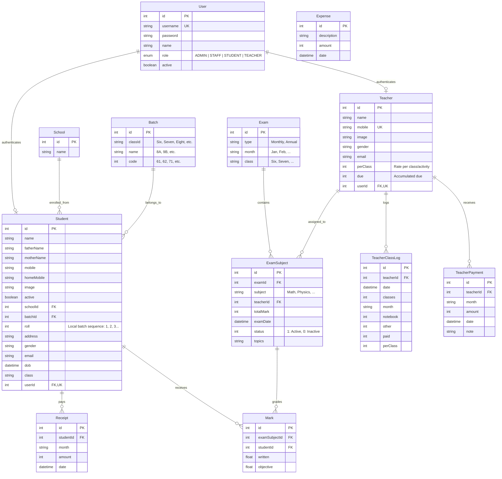
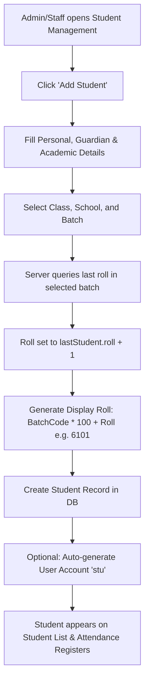
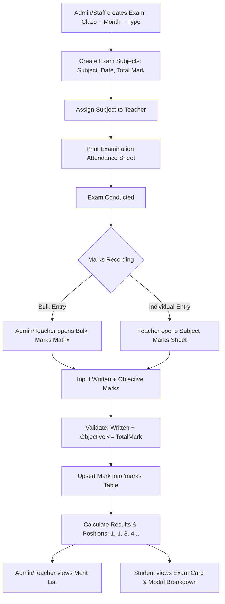
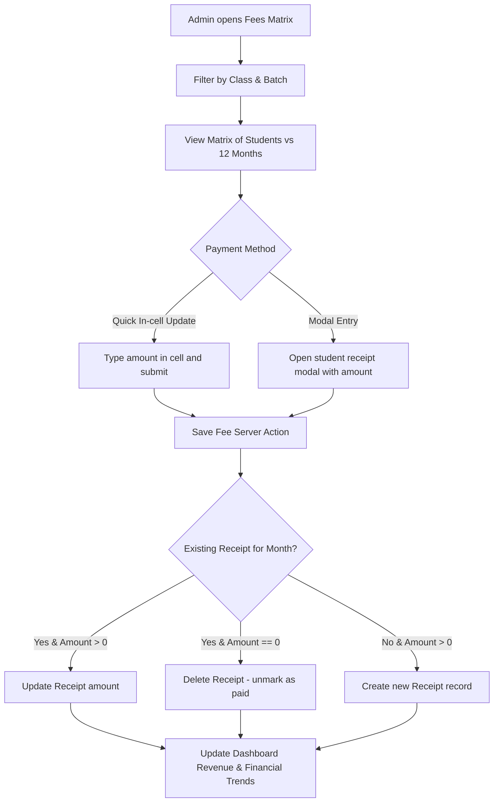

# Science Lab Coaching Center — System Architecture & Specification Document

> **System Name:** Science Lab Coaching Center Management System (`sciencelab` / `coaching-center`)
> **Target Audience:** System Administrators, Developers, Product Managers, UI/UX Designers  
> **Purpose:** Baseline documentation of system architecture, data models, user workflows, interface structure, and upgrade roadmap. 

---

## 1. System Overview

**Science Lab Coaching Center** is a full-stack educational and administrative ERP platform tailored for coaching centers and schools in Bangladesh. It handles the complete lifecycle of coaching operations: student admissions, batch management, exam planning, subject allocation, marks recording, merit ranking, monthly tuition fee collection, teacher class logs, payroll calculation, operational expense tracking, and role-specific portal access for Administrators, Staff, Teachers, and Students.

### Core Technology Stack

| Layer | Technology | Version / Notes |
| :--- | :--- | :--- |
| **Framework** | Next.js (App Router) | `14.2.23` |
| **Language & Runtime** | TypeScript / Node.js | TypeScript `^5.0.0`, Node 20+ |
| **UI & Styling** | Tailwind CSS + Radix UI + Lucide Icons | Tailwind `3.4.1`, Radix UI primitives, Lucide React icons |
| **Component Kit** | Custom Shadcn/ui-inspired primitives | Button, Badge, Card, Dialog, Modal, Input, Table |
| **Database & ORM** | PostgreSQL + Prisma ORM | Prisma Client & CLI `^7.2.0`, `@prisma/adapter-pg` |
| **Authentication** | NextAuth.js | `^4.24.13` (JWT session strategy, bcryptjs credentials) |
| **Data Fetching** | Server Actions + Route Handlers (`/api`) + SWR | Hybrid approach across modules |
| **Data Visualization** | Recharts | `^3.8.0` for charts and analytics |
| **Notifications** | Sonner | `^2.0.7` for toast messages |
| **Form Management** | React Hook Form + Zod | `react-hook-form ^7.69.0`, `zod ^4.3.4` |

---

## 2. System Architecture & Directory Structure

```
sciencelab/
├── app/
│   ├── (auth)/
│   │   └── login/                     # Authentication entrypoint
│   ├── actions/                       # Next.js Server Actions (mutations & queries)
│   │   ├── batches.ts                 # Batch CRUD
│   │   ├── dashboard.ts               # Dashboard aggregated metrics
│   │   ├── data.ts                    # General data fetching actions
│   │   ├── exams.ts                   # Exam creation and management
│   │   ├── expenses.ts                # Institution operational expenses
│   │   ├── fees.ts                    # Tuition fee payments
│   │   ├── marks.ts                   # Individual & bulk marks entry
│   │   ├── receipts.ts                # Fee receipt generation
│   │   ├── registration.ts            # User and student/teacher onboarding
│   │   ├── schools.ts                 # Partner school records
│   │   ├── student-results.ts         # Student result summaries & modal details
│   │   ├── students.ts                # Student CRUD
│   │   ├── subjects.ts                # Exam subjects & teacher assignments
│   │   ├── teacher-analytics.ts       # Class logs, earnings, and stats
│   │   ├── teacher-payments.ts        # Teacher payroll disbursements
│   │   ├── teachers.ts                # Teacher CRUD
│   │   └── users.ts                   # System user accounts & roles
│   ├── admin-route/                   # Admin & Staff portal
│   │   ├── layout.tsx                 # Protected Admin layout & role-filtered sidebar
│   │   ├── dashboard/                 # Institutional stats & financial analytics
│   │   ├── users/                     # Account management (Admin/Staff/Teacher/Student)
│   │   ├── schools/                   # Feeder schools list & management
│   │   ├── batches/                   # Class batches & codes (e.g. 61, 71)
│   │   ├── students/                  # Student directory, enrollment, printable rosters
│   │   ├── teachers/                  # Teacher roster, salary rates, dues
│   │   ├── exams/                     # Exam schedules, subjects, attendance sheets, results
│   │   ├── marks/                     # Bulk marks entry grid
│   │   ├── class-log/                 # Teacher daily class & task tracking
│   │   ├── fees/                      # Student monthly tuition fee matrix
│   │   ├── receipts/                  # Fee receipt archive
│   │   ├── expenses/                  # Institutional expense records
│   │   ├── payments/                  # Teacher payment records
│   │   └── profile/                   # Admin account settings & password updates
│   ├── teacher-route/                 # Faculty portal
│   │   ├── layout.tsx                 # Teacher role gate
│   │   ├── dashboard/                 # Teacher stats (assigned exams, submitted marks, due)
│   │   ├── exams/                     # Assigned exams & subjects
│   │   ├── marks/                     # Marks entry for assigned subjects
│   │   ├── results/                   # Merit list & performance overview
│   │   ├── class-log/                 # Personal class and task entry
│   │   ├── payments/                  # Payment history & calculated dues
│   │   └── profile/                   # Profile & credentials management
│   ├── student-route/                 # Student portal
│   │   ├── layout.tsx                 # Student role gate
│   │   ├── dashboard/                 # Student summary (recent exams, rank, fees)
│   │   ├── results/                   # Detailed exam report cards & position in class
│   │   ├── fees/                      # Monthly payment status & receipts
│   │   └── profile/                   # Personal academic profile
│   ├── api/                           # REST-style API route handlers
│   │   ├── auth/[...nextauth]/        # NextAuth handler
│   │   ├── batches/                   # Batch queries by class
│   │   ├── exams/                     # Exam queries, attendance, and result endpoints
│   │   ├── fees/                      # Student fee queries by class/batch
│   │   ├── marks/                     # Marks queries by exam and exam-subject
│   │   ├── student/results/           # Student result endpoint
│   │   ├── students/                  # Student queries
│   │   └── teacher/results/           # Teacher result endpoint
│   ├── globals.css                    # Global styling & Tailwind utilities
│   ├── layout.tsx                     # Root HTML & body wrapper
│   └── page.tsx                       # Root redirect (directs to /login)
├── components/
│   ├── forms/                         # Entity creation/update form dialogs
│   ├── layout/                        # Sidebar and navigation components
│   ├── profile/                       # Profile cards, edit modals, password forms
│   ├── providers/                     # NextAuth session providers
│   ├── results/                       # Result headers, print templates, merit tables
│   ├── ui/                            # Reusable base components (DataTable, Modal, Button)
│   ├── BatchList.tsx                  # Batch management table & actions
│   ├── ExamList.tsx                   # Exam schedule table & actions
│   ├── ExpenseList.tsx                # Expense tracking table & actions
│   ├── ReceiptList.tsx                # Receipt listing table
│   ├── SchoolList.tsx                 # School listing table
│   ├── StudentList.tsx                # Student directory table with roll formatting
│   ├── SubjectList.tsx                # Exam subject assignment table
│   ├── TeacherList.tsx                # Teacher directory & rate table
│   ├── TeacherPaymentList.tsx         # Teacher payment history table
│   └── UserList.tsx                   # User authentication account table
├── lib/
│   ├── auth.ts                        # NextAuth configuration and credentials provider
│   ├── calculateResults.ts            # Exam merit list ranking and position calculation
│   ├── export.ts                      # CSV export utility
│   ├── fuzzy-search.ts                # Fuzzy string matching algorithm
│   ├── permissions.ts                 # Fine-grained RBAC permission matrix
│   ├── prisma.ts                      # Prisma client singleton
│   ├── rbac.ts                        # Basic role check helper
│   ├── roll.ts                        # Roll number generation logic: `(batchCode * 100) + roll`
│   └── utils.ts                       # ClassName merger (`clsx` + `tailwind-merge`)
├── middleware.ts                      # Edge middleware for authentication gating
└── prisma/
    ├── schema.prisma                  # Prisma schema definition
    └── seed.ts                        # Database seeding script
```

---

## 3. Database Schema & Domain Entity Relationships



---

## 4. User Roles & Permission Matrix

The application defines 4 distinct roles in `lib/permissions.ts`:

| Module / Action | `ADMIN` | `STAFF` | `TEACHER` | `STUDENT` |
| :--- | :---: | :---: | :---: | :---: |
| **System Dashboard (Basic)** | View | View | View | View |
| **Financial Stats (Revenue, Expense, Net Balance)** | Full Access | Hidden | Hidden | Hidden |
| **User Management (Create, Edit, Delete)** | Full Access | No | No | No |
| **School Management** | Full Access | Full Access | No | No |
| **Batch Management** | Full Access | Full Access | No | No |
| **Student Directory & Admissions** | Full Access | Full Access | No | No |
| **Teacher Directory & Pay Rates** | Full Access | View/Create/Edit (Rates Hidden) | No | No |
| **Exam Planning & Schedules** | Full Access | Full Access | View Assigned | View Own Class |
| **Marks Entry** | Full Access | Full Access | Assigned Subjects | No |
| **Results & Merit Lists** | Full Access | Full Access | View | View Own Result |
| **Tuition Fees & Receipts** | Full Access | No | No | View Own Receipts |
| **Institution Expenses** | Full Access | No | No | No |
| **Teacher Class Logs** | Full Access | Create/Edit (No Delete) | Own Logs Only | No |
| **Teacher Payments (Disbursements)** | Full Access | No | View Own History | No |
| **Profile & Password Settings** | Self | Self | Self | Self |

---

## 5. End-to-End System Workflows

### 5.1. Student Admission & Roll Number Calculation Flow


### 5.2. Exam, Marks Entry & Result Generation Flow


### 5.3. Tuition Fees & Receipt Flow


### 5.4. Teacher Class Log & Payroll Flow
```mermaid
flowchart TD
    A[Teacher / Admin logs Daily Activity] --> B[Input Date, Class Count, Notebooks, Other tasks]
    B --> C[Save into 'teacher_class_logs']
    C --> D[System calculates Total Activities * Teacher.perClass]
    D --> E[System sums All Activities for Month]
    E --> F[System deducts Teacher Payments for Month]
    F --> G[Real-time Current Due = (Activities * Rate) - TotalPaid]
    G --> H[Admin creates Teacher Payment]
    H --> I[Save 'teacher_payments' record]
    I --> J[Automatically create Expense entry in 'expenses']
    J --> K[Revalidate Admin & Teacher Dashboards]
```

---

## 6. Current Interface & UX Analysis

### 6.1. Navigation & Layout
- **Fixed Desktop Sidebar**: 64-width fixed sidebar (`bg-gray-800 text-white`).
- **Mobile Sidebar**: Slide-over drawer toggled by top-left hamburger icon.
- **Header**: Basic title + current panel label ("Admin Panel", "Teacher Panel", "Student Panel").
- **Logout Action**: Prominent bottom red button calling `signOut()`.

### 6.2. Key Screen Breakdown

1. **Dashboard (`/admin-route/dashboard`)**:
   - Metric cards: Students, Teachers, Exams, Batches, Total Revenue, Expenses, Net Balance.
   - Quick activity list.
   - Recharts breakdowns: Gender ratio, class enrollment, feeder schools, monthly financial trends.
2. **Student Directory (`/admin-route/students`)**:
   - `DataTable` with fuzzy search on Name, Mobile, and Display Roll.
   - Class and Batch dropdown filters.
   - Add/Edit student modal dialog.
   - CSV Export & Printable view navigation (`/admin-route/students/print`).
3. **Bulk Marks Entry (`/admin-route/marks`)**:
   - Dynamic filters by Class, Month, and Subject.
   - Table of students with Written & Objective input fields.
   - Validation against maximum subject marks with instant total sum.
   - Bulk save button triggering `bulkSaveMarksAction`.
4. **Fees Tracker (`/admin-route/fees`)**:
   - 12-month grid layout showing payment statuses across all students in a batch.
   - SWR-driven optimistic updates with quick-entry and modal modes.
5. **Teacher Class Log (`/admin-route/class-log`)**:
   - Date, class count, notebook checks, and special task log tracker.
   - Dual view modes: Cards summary vs Detailed table.
   - Role-gated financial masking for STAFF role.
6. **Student Portal (`/student-route/...`)**:
   - **Exam Cards**: Summary cards showing Exam Name, Class, Month, Marks obtained / Max marks, Percentage badge, and Competition rank.
   - **Result Modal**: Breakdown per subject showing Subject Name, Teacher, Written, Objective, Total, Subject Rank.

---

## 7. Critical Architecture & Technical Observations

> [!WARNING]
> The following areas contain critical architectural issues, performance bottlenecks, or user flow fragmentation that should be resolved in the upgrade.

### 1. Route Redirection Bug in Middleware
In [middleware.ts](file:///home/orion/Documents/Projects/sciencelab/middleware.ts#L14):
```typescript
if (role === "STAFF") redirectUrl = "/staff-route/dashboard";
```
There is **no** `/staff-route` directory in the project. Staff actually uses `/admin-route/dashboard` with role-filtered navigation items defined in `lib/permissions.ts`. A staff login redirect currently fails or hits a 404 route.

### 2. Client-Side Sequential N+1 Waterfall in Marks Entry
In [app/admin-route/marks/page.tsx](file:///home/orion/Documents/Projects/sciencelab/app/admin-route/marks/page.tsx#L64-L76):
```typescript
const allSubjects: ExamSubject[] = [];
for (const exam of data) {
  const subjectRes = await fetch(`/api/exams/${exam.id}`);
  const examData = await subjectRes.json();
  // ...
}
```
Fetching subjects via a sequential client-side `for` loop triggers $N$ sequential HTTP requests on page load. With 20 exams, this makes 21 sequential roundtrips before the UI renders.

### 3. Result Calculation Single-Point-of-Failure
In [lib/calculateResults.ts](file:///home/orion/Documents/Projects/sciencelab/lib/calculateResults.ts#L4):
```typescript
let marks = exam.subjects[0].marks;
```
The algorithm derives the list of students exclusively from the marks of the **first subject** (`subjects[0]`). If `subjects[0]` is missing or if a student was absent for only that first subject, the student is completely dropped from the overall merit list.

### 4. Fragmented Table & Component Ecosystem
There are two competing table implementations:
- `components/ui/data-table.tsx` (Fuzzy search, client pagination, debouncing)
- `app/admin-route/components/AdminTable.tsx` (Separate search, different styling)  
This produces visual inconsistencies, duplicated logic, and differing behaviors across pages.

### 5. Lack of Database Transactions on Coupled Financial Writes
In [app/actions/teacher-payments.ts](file:///home/orion/Documents/Projects/sciencelab/app/actions/teacher-payments.ts#L25-L45):
Payment creation and Expense creation are executed as two independent queries without `prisma.$transaction`. If the second query fails, payment is logged without matching institution expenses, skewing financial integrity.

---

## 8. Strategic Upgrade Roadmap (UI & Flow Modernization)

### Phase 1: Core Foundation & Route Normalization
1. **Fix Middleware & Role Routing**:
   - Align `STAFF` routing to `/admin-route/dashboard` or create a clean `/staff-route` alias.
   - Enforce server-side layout guards consistently.
2. **Standardize Data Layer**:
   - Replace sequential client-side fetch waterfalls with unified Server Actions utilizing Prisma `include`.
   - Wrap multi-table financial operations (Payments + Expenses) in `prisma.$transaction`.
3. **Robust Merit List Engine**:
   - Refactor `calculateResults.ts` to collect all unique students across all subjects or from the batch enrollment directly.

### Phase 2: Design System & UI Modernization
1. **Unified Design System**:
   - Adopt a single modern design palette (Tailwind slate/zinc base, refined typography, consistent focus rings and elevation).
   - Consolidate `AdminTable` and `DataTable` into a single, high-performance TanStack Table-backed data component with server-side pagination support.
2. **Modern Navigation & Shell**:
   - Modern collapsible sidebar with icon-only mode, active pills, breadcrumbs header, quick notifications bell, and global search trigger.
   - Responsive top app bar with role badge, quick actions button (e.g. "+ Quick Admission", "+ Mark Payment"), and user profile dropdown.

### Phase 3: Workflow & Flow Optimizations
1. **Streamlined Admission & Enrollment Flow**:
   - Step-by-step wizard for new students: Step 1: Student info -> Step 2: Guardian & Academic details -> Step 3: Batch assignment & automated ID card / display roll preview.
2. **Speed-Entry Marks & Attendance Flow**:
   - Keyboard-accessible marks entry grid (Arrow keys navigation between cells, automatic tab index, live validation indicator).
   - Real-time batch-wise student attendance marker before exam grading.
3. **Financial & Tuition Experience**:
   - Unified Accounts Hub: Combined fee collections, overdue alerts, payment receipts, institution expenses, and teacher disbursements with instant PDF receipt downloading.
4. **Enhanced Student & Parent Portal**:
   - Mobile-first student dashboard with progress radar/bar charts, rank badges, downloadable term report cards, and fee status timeline.

---
*Generated for Science Lab Coaching Center — System Upgrade Documentation.*
